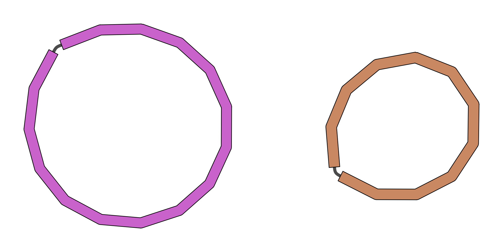

# BIO191 Capstone: Hybrid Genome Assembly of VH59KT_2 (Bud11)

Hybrid *de novo* genome assembly of sample `VH59KT_2_sample_2_Bud11`, using
Oxford Nanopore long reads to build the assembly and Illumina paired-end short
reads to polish it.

## Results

| Metric | Value |
|---|---|
| Total length | 5,584,367 bp |
| Contigs | 2, both reported circular by Flye |
| Contig N50 | 3,257,901 bp (unpolished) |
| GC content | 66.66% |
| Mean long-read coverage | 55x |

| Contig | Flye length (bp) | Polished length (bp) | GC | Coverage | Circular |
|---|---|---|---|---|---|
| `contig_1` | 3,257,901 | 3,257,902 | 66.71% | 51x | Yes |
| `contig_2` | 2,326,466 | 2,326,465 | 66.58% | 61x | Yes |

The final assembly is [`VH59KT_2_polished.fasta`](VH59KT_2_polished.fasta).



## Approach

```text
ONT reads ──> NanoPlot (QC) ──> length/quality filtering ──> Flye ──> draft assembly ──┐
                                                                                       ├──> Polypolish ──> polished assembly
Illumina reads ──> fastp (trim + QC) ──> BWA-MEM (against draft) ──> insert filter ────┘
```

### 1. Long-read QC (NanoPlot 1.48.0)

Run on the unfiltered reads, `VH59KT_2_ont.fastq.gz`.

| Reads | Bases | Mean length | Read N50 | Mean quality | Reads >Q20 |
|---|---|---|---|---|---|
| 31,620 | 325.4 Mb | 10,290.8 bp | 20,671 bp | 21.0 | 81.6% |

### 2. Long-read filtering

| | Reads | Bases | Shortest read |
|---|---|---|---|
| Before | 31,620 | 325,395,572 | 500 bp |
| After | 21,668 | 309,126,841 (95.0%) | 2,390 bp |

The tool and parameters are not recorded in the project files.

### 3. Short-read trimming and QC (fastp 1.0.1)

```bash
fastp -i VH59KT_2_sample_2_Bud11_illumina_R1.fastq.gz \
      -I VH59KT_2_sample_2_Bud11_illumina_R2.fastq.gz \
      -o VH59KT_2_sample_2_Bud11_trim_R1.fastq.gz \
      -O VH59KT_2_sample_2_Bud11_trim_R2.fastq.gz \
      --detect_adapter_for_pe --length_required 50 --thread 8 \
      -h fastp.html -j fastp.json
```

| | Reads | Bases | Q20 | Q30 | GC |
|---|---|---|---|---|---|
| Before | 13,909,890 | 2.10 Gb | 98.8% | 95.2% | 65.7% |
| After | 13,759,760 | 2.06 Gb | 99.1% | 95.8% | 65.8% |

### 4. Long-read assembly (Flye 2.9.6)

```bash
flye --nano-raw VH59KT_2_ont_filtered.fastq.gz --out-dir flye/ --threads 8
```

### 5. Short-read alignment (BWA 0.7.19)

Each mate file is aligned separately, with `-a` reporting all alignments so
that Polypolish can use reads from repeats.

```bash
bwa index flye/assembly.fasta
bwa mem -t 8 -a flye/assembly.fasta VH59KT_2_sample_2_Bud11_trim_R1.fastq.gz > VH59KT_2_aln_1.sam
bwa mem -t 8 -a flye/assembly.fasta VH59KT_2_sample_2_Bud11_trim_R2.fastq.gz > VH59KT_2_aln_2.sam
```

### 6. Short-read polishing (Polypolish)

The commands below are reconstructed from the output files and are not taken
from a log. The Polypolish version is not recorded.

```bash
polypolish filter --in1 VH59KT_2_aln_1.sam --in2 VH59KT_2_aln_2.sam \
                  --out1 VH59KT_2_filt_1.sam --out2 VH59KT_2_filt_2.sam
polypolish polish flye/assembly.fasta VH59KT_2_filt_1.sam VH59KT_2_filt_2.sam > VH59KT_2_polished.fasta
```

The local SAM files have extra `-001` to `-004` suffixes in their names.

## Repository contents

| Path | Description |
|---|---|
| `VH59KT_2_polished.fasta` | Final polished assembly |
| `flye/assembly.fasta` | Draft assembly |
| `flye/assembly_graph.gfa`, `.gv` | Assembly graph |
| `flye/assembly_info.txt` | Contig length, coverage and circularity |
| `flye/params.json` | Flye run parameters |
| `flye_graph.png` | Assembly graph image |
| `fastp.html`, `fastp.json` | Short-read QC reports |
| `nanoplot/` | Long-read QC report, statistics and PNG plots |

## Ignored files

These are excluded by [`.gitignore`](.gitignore) because they are large or can
be regenerated. The ignored files total over 14 GB.

| Files | Pattern | Approx. size |
|---|---|---|
| Original reads | `ont and illumina reads (from FIC)/` | 1.3 GB |
| ONT reads, unfiltered and filtered | `*.fastq.gz` | 583 MB |
| Trimmed Illumina reads | `*.fastq.gz` | 859 MB |
| Alignments and Polypolish-filtered alignments | `*.sam` | 4 x 2.9 GB |
| BWA index of the draft | `*.amb`, `*.ann`, `*.bwt`, `*.pac`, `*.sa` | Regenerable |
| Flye intermediate stages | `flye/00-assembly/` to `flye/40-polishing/` | Regenerable |
| Individual NanoPlot HTML plots | `nanoplot/*.html`, except `NanoPlot-report.html` | Regenerable |
| Logs | `*.log`, `*.stderr` | Small |

The `.gitignore` also covers other read, alignment, index, coverage and variant
formats, workflow caches, Python/R/editor/OS files and `.env`.

To reproduce the analysis, obtain the original reads separately and place them
in `ont and illumina reads (from FIC)/`. The commands above assume the input
reads are available in the project root; `VH59KT_2_ont.fastq.gz` has the same
read and base counts as the original Nanopore file.
